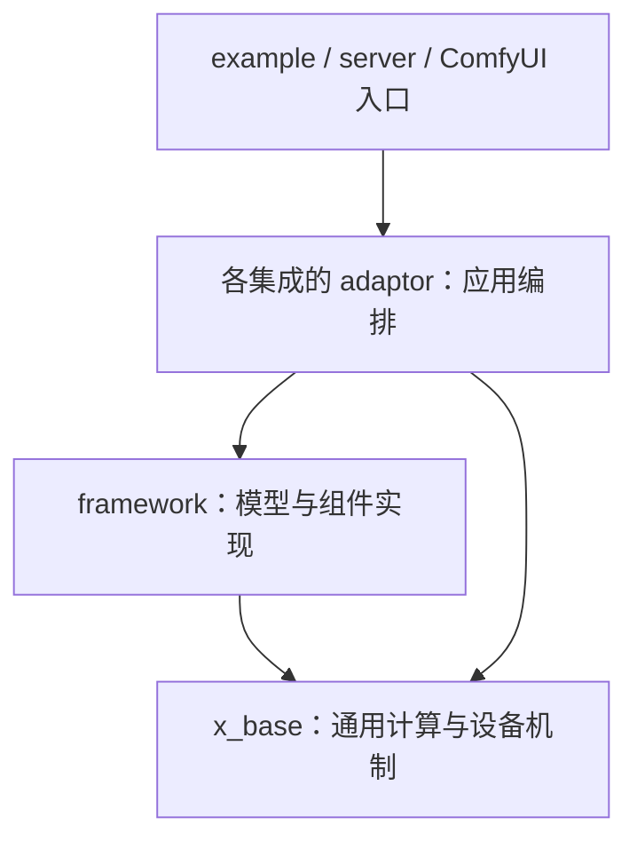

# xGen 架构与职责

[文档目录](README.md)

xGen 将设备与计算机制、模型实现、应用编排、用户入口分层。依赖由上层指向下层：



`framework` 不导入 adaptor；`x_base` 不导入 Diffusers、ComfyUI 或 server。不同集成复用 `x_base`，不互相依赖对方的模型或服务实现。

ComfyUI 在 `adaptor/model_hooks.py` 读取环境和节点覆盖、安装模型加载钩子并处理工作流缓存失效。文本 TP、Transformer 的 SP/量化/FSDP 和 VAE copy-stream 接收显式设置，framework 不再导入 `adaptor.env`。

每次工作流执行前重新解析唯一的 NPUTurbo 控制节点；没有节点时清除上次覆盖并恢复环境默认值。INT8/AdaLN 的实际配置变化会清除模型缓存，实际 TP 大小变化只清除 CLIP 及其下游缓存；attention、PHAA 和 RoPE 同步应用本次设置。节点执行与提前扫描共用同一套解析和应用函数。

<a id="layers"></a>
## 分层职责

| 层 | 负责内容 | 主要位置 |
|---|---|---|
| 通用机制 | 设备接口、算子、通信、TP/SP、offload、缓存基础能力 | `x_base/x_base/` |
| 模型实现 | 模型层、attention/投影适配、编解码、模型内部采样与计算流程 | `x_diffusers/x_diffusers/framework/` |
| 应用编排 | 参数规则、组件加载、能力选择、装配、设备放置和请求生命周期 | `x_diffusers/x_diffusers/adaptor/` |
| 用户入口 | 文件读写、CLI、HTTP、队列、请求协议和结果发布 | `example/`、`server/`、各集成入口 |

通用 TP 算法和通信位于 `x_base`；H3 的层分片、布局和输入输出适配位于 framework Transformer；adaptor 根据开关选择和装配。这一分工同样适用于 VAE、精度与融合能力。

模型内部的 Base → Refiner 计算顺序属于模型 Pipeline。选择何种模型、何时装载组件、如何接收请求属于应用编排。

Refiner 的 `H3RefinerConfig` 只包含模型装载设置，`H3RefinerRequest` 只包含 prompt、seed、时长和已加载素材。Pipeline 保留 Base → 条件编码/上采样 → Refiner → 解码的计算顺序，通过 `H3RefinerOutput` 交付音频和帧，并返回 `H3RefinerResult`。`h3_runtime` 实现视频写入、原子替换和指标文件交付；模型不接收整包 CLI/HTTP 参数或输出路径。

Refiner 加载与整个请求生命周期使用 `x_base.utils.distributed.DistributedFailureGuard`。独立 Gloo CPU 通道在后台检测 rank 报错或失联，任一失败使整组 worker 以非零状态退出，交由 torchrun 管理；异常后不再进入设备 barrier。素材、写入器初始化、推理、指标和清理错误都在监测范围内。正常退出等待所有 rank 完成清理。Gloo 必须可用；默认 10 秒超时约束心跳通信，不限制健康请求的推理时长。

<a id="configuration-flow"></a>
## 配置与请求如何流动

| 文件 | 职责 |
|---|---|
| `adaptor/config.py` | 参数与选项定义 |
| `adaptor/validation.py` | 默认值、预设解析、资产匹配、参数与组合校验 |
| `adaptor/load_pipe.py` | 统一加载、组件装配、开关应用和设备放置 |
| `adaptor/h3_runtime.py` | H3 请求参数转换、素材条件、执行上下文及成功/失败后的清理 |
| `adaptor/runtime_env.py` | 设备、分布式和 CFG 并行环境初始化 |
| `framework/h3_config.py` | 模型所需的配置对象、形状和采样规则 |

adaptor 向模型机制传递解析后的设置；模型组件不负责解析 CLI 或启动 JSON。保留的 `DEBUG_TIME`、`VAE_COPY_STREAM` 兼容开关属于存量行为，新能力优先使用显式配置。

`load_pipe(args)` 返回完成组件装配、LoRA 和设备放置的 Pipeline。调用方复用此入口；初始化顺序通过 `PipelineBuildOptions` 表达。

<a id="model-layout"></a>
## Diffusers 模型文件组织

H3 在每个组件目录按视频和图像模型收拢：

```text
x_diffusers/x_diffusers/framework/
├── pipeline/
│   ├── minimax_h3.py
│   └── minimax_h3_image.py
├── transformer/
│   ├── minimax_h3.py
│   └── minimax_h3_image.py
├── vae/
│   ├── minimax_h3.py
│   └── minimax_h3_image.py
├── lora/minimax_h3.py
├── h3_config.py
├── h3_encoders.py
├── offload.py
└── _vendor/
    ├── h3_regenerate/
    └── omni_h3/
```

其他模型保留各自文件。`h3_encoders.py` 提供视频和 Image 共用的文本/视觉适配，`offload.py` 提供共用钩子。第三方包保留原有结构、许可证、来源和版本记录，避免与自有模型代码混合维护。

`import x_diffusers` 与纯参数解析（`parse_args(bootstrap_environment=False)`）使用轻量入口，不导入 Torch、模型或注册补丁。`init_env()` 和 `load_pipe()` 在运行时调用幂等的 `initialize_framework()`，按原有顺序注册模型适配与 Pipeline 映射。直接使用原生 Diffusers、依赖 xGen 全套补丁的调用方，需要先显式调用 `x_diffusers.initialize_framework()`。普通模块导入检查、独立函数测试和完整包初始化测试覆盖不同范围。

<a id="entrypoints"></a>
## 入口与离线工具

视频 CLI 使用 `example/diffusers/infer.py`；Image 的 `run_image(args, pipe=None)` 负责参考图文件、预热、计时和 PNG/JSON 输出。Image 的模型执行使用 `h3_runtime.generate_h3_images`，结果处理留在 framework Pipeline。

HTTP 服务处理输入协议、队列、探针、取消和结果发布，通过原 Manager 调用模型。MaaS 身份、租户、配额和计费由上层平台负责，CUDA/NPU 的计算选择与协议字段分开。

HTTP 下载或解析得到本地素材后，与 CLI 共用 `h3_runtime.prepare_h3_media` 加载有序素材、应用尺寸选项和选择 AdaLN 表。视频音轨是否参与条件由共享校验决定，`enable_audio` 只控制输出音频；HTTP 不再单独维护音轨探测或 AdaLN 切换逻辑。

普通批量入口 `example/diffusers/infer_batch.py` 调用 Manager 的 `infer_batch`，负责正常数据集推理。VAE 速度矩阵、输出对照目录和报告生成集中在 `tools/evaluate_vae.py`；工具调用批量 API，并通过输出路径函数与成功回调接收结果。Manager 不解释评测模式，也不导入工具。

`tools/` 放环境采集、权重转换、资产准备及独立评测工具。AdaLN/Refiner 工具提前生成可复用模型资产；`load_pipe` 加载资产。它们不在逐请求计算链路内。

<a id="validation"></a>
## 开发检查

在独立开发环境执行：

```bash
python -m pip install -r requirements-quality.txt
python tools/check_quality.py
```

入口运行 Ruff、语法与可独立执行的源码布局、装配顺序、批量推理/评测、工作流及 ComfyUI 测试。CPU PyTorch 环境可另运行 `python tests/test_tp_projections_cpu.py` 和 `python tests/test_distributed_failure_cpu.py`；后者使用本机两个 Gloo 进程测试成功、异常和失联退出，不加载模型。模型、参数和请求运行时测试采用正常模块导入，需要安装相应 xGen 运行环境。

这些检查不包含模型权重出图、视频/音频质量或设备性能验收。对运行行为的修改，应以一致的模型、输入顺序、seed 和配置完成对应设备验证，分别记录功能结果与质量结果。
