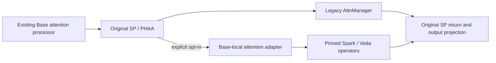

# Experimental H3 Base attention

v0.3 adds model-local Spark-H3 and Veda operators to the existing XGEN H3
processor and PHAA callback. `--h3_attention legacy` is the default. It keeps
the v0.2 attention selection, models, scheduler, offload, cache, VAE and codecs.
This feature is experimental; implementation is not a claim of validation.

Initial qualification: T2VA, batch one, 1344x768 Base, 124 native frames,
24fps, SP8, BF16 Q/K/V, 50 actual DiT evaluations (`num_inference_steps=51`).
The existing optional Refiner exports 2560x1440/120 frames with three Laser
steps. Only Base attention changes. I2VA/R2VA, other frame counts, arbitrary
masks, extra LoRAs and a sparse Refiner are rejected or unsupported here.
Veda was released for an eight-NFE recipe: quality on the original 50-step
Base must be measured; a faster kernel alone is not a quality pass.

The existing managers, pipeline loops and Refiner chain retain ownership.
The optional callback replaces only the attention leaf inside Base:



## Source and optional compilation

Use the Apache-2.0 snapshot preceding the project's noncommercial license
change. Retain its third-party notices and CANN/Miowtion/Spark licenses.
No vLLM or vLLM-Omni runtime is installed or imported by this integration.
The existing Torch/TorchNPU/CANN installation must also provide compatible
Ascend Triton and CMake to compile the optional kernels. Main requirements
and default imports do not change.
XGEN owns the Base adapter, PHAA hook, shared-predictor lifetime and metrics;
the pinned optional checkout supplies Spark and the shared native/Triton
kernels/configuration. This is not a self-contained vendoring of every kernel.

```bash
git clone https://github.com/Huage001/Ascend-H3.git optional/Ascend-H3
git -C optional/Ascend-H3 checkout e02a57325029e67eafaf67d64b3d62a330f1e8d4
export PYTHONPATH="$PWD/optional/Ascend-H3/src:$PWD/x_diffusers:$PWD/x_base${PYTHONPATH:+:$PYTHONPATH}"
export H3_ASCEND_CACHE="$PWD/model-cache/h3-attention-native"
# Load the deployment environment's CANN setup first. Match the actual SoC.
python -c "from h3_ascend.build import build; build('spark',soc='Ascend910B1'); build('veda',soc='Ascend910B1')"
```

Build products stay in the external cache; they depend on Torch, TorchNPU,
CANN, ABI and SoC. Never reuse unverified binaries across environments.

## Parameters and examples

| Parameter | Default | Purpose |
|---|---|---|
| `--h3_attention` | `legacy` | `legacy`, `spark`, or `veda`; Base only |
| `--h3_veda_predictor` | unset | Local published predictor file; required only by Veda |

Use the existing 2K launcher and asset preparation in H3-DEPLOYMENT.md:

```bash
export TASK_QUEUE_ENABLE=1  # Spark graph capture; use the same mode for baseline comparisons.
bash example/diffusers/scripts/infer_minimax_h3_refiner.sh --h3_attention spark
bash example/diffusers/scripts/infer_minimax_h3_refiner.sh \
  --h3_attention veda --h3_veda_predictor weights/veda/predictor.safetensors
```

For Spark, export `TASK_QUEUE_ENABLE=1` before starting Python/torchrun
(queue mode 0 is also graph-compatible). TorchNPU rejects Spark's NPU graph
capture with queue mode 2; validation fails before model loading if mode 1/0
was not explicitly selected. This integration does not change the environment
automatically. Benchmark Laser and Spark with the same queue mode; a queue-2
Laser baseline is not a controlled queue-1 Spark comparison.

The launcher requires the existing BASE_MODEL, BASE_TRANSFORMER, BASE_ADALN,
REFINER_WEIGHTS and REFINER_PREPARED environment variables. Do not replace
the 51-point AdaLN table or automatically enable an eight-step LoRA.
For 768P use the original CLI with the same Base configuration, width=1344,
height=768 and frames=124, without `--h3_refiner`, and add the desired backend.
Default H3 export may retain 124 native frames; the benchmark must state its
crop/encode accounting instead of hiding a 120-vs-124-frame difference.

Veda predictor source:
`Veda-Sparse/Minimax-H3-T2VA-Veda-8NFE-600Step-Preview`, revision
`76f202874608115408d73280be9531c4ab888242`, file
`minimax_h3_t2va_veda_8nfe_600step_preview_fp8.safetensors`.
The validated file is 275,415,648 bytes, SHA256
`2a8d8845c5342756a2781e8e69563940e4bb573c9a40ebb534915ff8fd76573a`.
FP8 file size is not the predictor's runtime memory footprint. The decoded
predictor has immutable CPU masters, is shared across layers/head chunks,
loads to NPU for Base, and offloads before Refiner/VAE. No condition cache or
request retry is added. Routing is recomputed for every Q/K call.

## Observability, recovery and validation

Each request writes `<output>.attention.rankN.json`: backend, actual Base
steps, per-rank global head IDs, predictor load count, and operator/pack/unpack
spans. Operator spans include prediction and routing; do not call them pure
attention-kernel time. `first_use` marks the first invocation of a head-shard
program, not every later layer's first JIT specialization. Compare complete
first-request and subsequent-request times to account for all compilation and
graph setup; do not infer steady-state latency from a single flagged span.
No silent fallback occurs.
After a request error or backend/predictor change, restart the worker. To roll
back, restart without the new flags or with `--h3_attention legacy`.
Also restore the deployment's original task-queue environment if it was
changed for Spark; selecting `legacy` does not rewrite process environment.

Qualification requires frozen inputs and separate numerical and performance
runs: compare the adapter against pinned upstream math on identical Q/K/V
and global head shards (including PHAA's 4+3 split), measure approximation
against dense attention separately, then generate paired Laser/Spark/Veda
5s videos at 768P/2K. Keep initialization, request latency, stage spans,
allocated/reserved HBM, driver HBM, PSS and release snapshots separate.
Full decoding and same-time screenshots are required; screenshots alone do
not establish temporal/audio quality. Repeated Laser controls establish the
existing nondeterminism floor before attributing output differences.

The CPU contract tests require the repository's `origin/v0.1` and `origin/v0.2`
baseline refs. Run them from the repository root; the NPU operator checker
additionally requires the optional compiled dependencies above:

```bash
python x_diffusers/tests/test_h3_refiner_opt_in.py
python x_diffusers/tests/test_h3_attention_contract.py
TASK_QUEUE_ENABLE=1 python tools/check_h3_attention.py \
  --backend spark --output verification/spark-operator.json
TASK_QUEUE_ENABLE=1 python tools/check_h3_attention.py \
  --backend veda --predictor weights/veda/predictor.safetensors \
  --output verification/veda-operator.json
```

See [the 50-step qualification results](H3-ATTENTION-VALIDATION.md) for actual
hardware scope, timings, memory observations and the limits of quality review.
